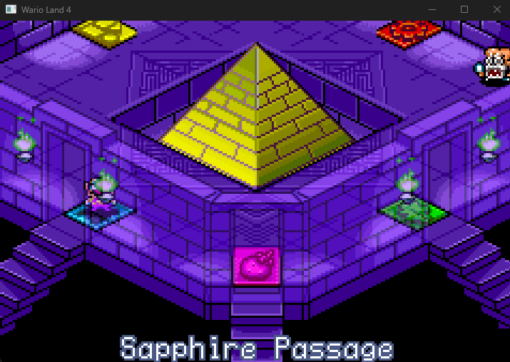
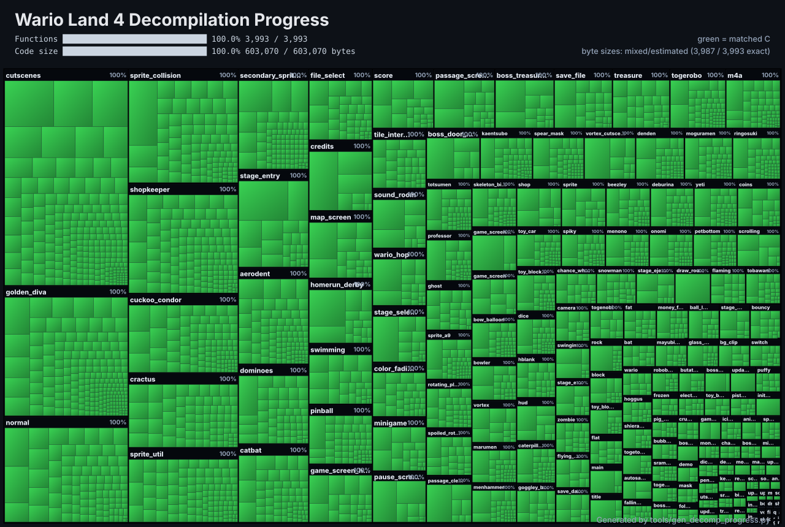

# Wario Land 4 — Native PC Port

## Windows v0.3.0-beta - The Rumble Update

[Download the Windows x64 release](https://github.com/BioRhythmicStudios/warioland4/releases/tag/v0.3.0-beta).
Extract the complete ZIP, open `wl4-launcher.exe`, select your own supported
unmodified US ROM and launch. No ROM is included.

Optional native SDL3 vibration is under Settings -> Controller, with On/Off,
strength and Test Rumble. It defaults Off; existing bindings, VSync and CRT
preferences migrate from older settings. Explicit Save writes v4 settings,
which older releases cannot read. SRAM remains compatible. Controller remapping,
CRT Lite/Enhanced, VSync, fullscreen and scaling remain available. The colour
restoration mod is not included. See [release details](docs/WINDOWS_BETA3_RELEASE.md).

## Screenshots

### Native Windows gameplay



*Wario Land 4 running natively on Windows using the BioRhythmicStudios PC port.*

A work-in-progress native Windows port by **BioRhythmicStudios**, built on the
**[Wario Land 4 decompilation by TsilaAllaoui and contributors](https://github.com/TsilaAllaoui/warioland4)**,
which derives from [lilDavid's original project](https://github.com/lilDavid/warioland4).
Their reverse engineering and decompilation work provides the foundation for this port.

The port compiles the decompiled game C code for x86-64 and supplies a native runtime
for graphics, sound, input and saves. Game assets are read from a user-supplied ROM
at runtime; the PC executable does not embed the game's ROM assets.

**Development preview:** Windows x64 is the implemented platform. A complete
full-game playthrough has not been verified. Manual Windows testing confirms
Hall of Hieroglyphs completion through the Frog Switch and escape, victory over
Spoiled Rotten, two rounds of Wario Hop through Game Over, and saved progress
loading after restart. This is an unofficial fan project, unaffiliated with Nintendo.

## Status and features

| Status | Capabilities |
| --- | --- |
| Implemented on Windows x64 | Boot, intro, title, file select, passage select and gameplay in Hall of Hieroglyphs |
| Implemented | SDL3 window, integer scaling from the original 240×160 resolution, fullscreen and fast forward |
| Implemented | Customizable keyboard/gamepad bindings, hotplug and optional native rumble |
| Implemented | CRT Lite/Enhanced filters and optional VSync |
| Implemented | Music and sound effects through a native m4a engine and modeled GBA sound hardware |
| Implemented | Persistent 32 KiB SRAM saves compatible with mGBA `.sav` files |
| Implemented developer tools | Headless execution, scripted input, memory/framebuffer capture, WAV output and mGBA comparison tools |
| Manually verified on Windows | Hall of Hieroglyphs completion, Spoiled Rotten victory and return to the Golden Pyramid, two Wario Hop rounds through Game Over, and save persistence after restart |
| Experimental / incomplete | Gameplay beyond the tested coverage, full-game automated validation, timing-sensitive raster effects and audio equivalence across lag frames |
| Planned | Full-playthrough validation, Linux x64, Android arm64, Japanese ROM support and widescreen experiments |

The project records mark milestones M0 (headless boot), M1 (renderer and window)
and M2 (initial level gameplay, sound and saves) complete. M3, full-playthrough
validation, remains incomplete. Planned platforms and enhancements are not current
build or compatibility promises.

## Bring your own ROM

You must supply your own legally obtained, unmodified Wario Land 4 ROM. This
repository does not provide a ROM or instructions for obtaining copyrighted game data.

The native port currently accepts only:

| Property | Required value |
| --- | --- |
| Version | US/EU, game code `AWAE` |
| Size | 8 MiB (8,388,608 bytes) |
| MD5 | `5fe47355a33e3fabec2a1607af88a404` |

The loader checks the size and MD5 and rejects other images. Japanese ROMs,
modified ROMs and ROM hacks are not currently supported by the native runtime.
No asset extraction or GBA compiler is required for a normal PC build using the
checked-in generated files.

## Build on Windows

Use the branch containing the native port (`port` in this repository). The documented
toolchain is **llvm-mingw, UCRT x86_64**, with **CMake 3.20+**, **Ninja** and **SDL3**.
The recorded setup uses llvm-mingw `20261006` and SDL3 `3.4.18`. MSVC is not the
documented build path.

1. Unpack [llvm-mingw](https://github.com/mstorsjo/llvm-mingw) and the MinGW SDL3
   development package from [SDL releases](https://github.com/libsdl-org/SDL/releases).
2. Put CMake, Ninja and llvm-mingw's `bin` directory on your `PATH`.
3. From the repository root, configure and build in PowerShell, replacing the paths
   below with your local installation directories:

```powershell
cmake -S . -B build_pc -G Ninja `
  --toolchain port/cmake/llvm-mingw-x86_64.cmake `
  -DLLVM_MINGW=C:/toolchains/llvm-mingw `
  -DCMAKE_BUILD_TYPE=RelWithDebInfo `
  -DSDL3_DIR=C:/toolchains/SDL3-3.4.18/x86_64-w64-mingw32/lib/cmake/SDL3
cmake --build build_pc
```

`SDL3_DIR` must point to the development package's `lib/cmake/SDL3` directory.
When SDL3 is found, the build copies `SDL3.dll` beside `wl4.exe`. Without SDL3,
the executable supports headless operation only.

For an AddressSanitizer build, configure a separate directory with `-DWL4_ASAN=ON`.
When running it, also add llvm-mingw's `x86_64-w64-mingw32/bin` directory to `PATH`
so the ASan runtime DLL can be found. See [port/README.md](port/README.md) for
runtime and generated-symbol maintenance details.

## Run and play

Pass the path to your supported ROM:

```powershell
.\build_pc\wl4.exe "C:\Games\Wario Land 4\baserom_us.gba"
```

The default window scale is 3×. Use `--scale N` to choose another integer scale.

| Key | Action |
| --- | --- |
| Arrow keys | D-pad |
| X / Z | A / B |
| A / S | L / R |
| Enter / Backspace | Start / Select |
| Tab (hold) | Fast forward; audio is dropped while fast forwarding |
| F11 | Toggle fullscreen |
| Escape | Quit |

The first gamepad uses positional buttons: bottom face button = A, right face
button = B. Configurable bindings are planned.

Windowed play stores saves at `%APPDATA%\wl4\wl4.sav` by default. To choose a
save file:

```powershell
.\build_pc\wl4.exe "C:\Games\baserom_us.gba" --save "C:\Games\wl4.sav"
```

Saves use mGBA's raw 32 KiB SRAM format and can be transferred between the two.
The runtime uses atomic replacement after SRAM changes settle and also saves on
quit. Back up existing saves before development testing; headless runs write saves
only when `--save FILE` is supplied and can overwrite that file.

## Known bugs and limitations

- **Incomplete gameplay coverage:** manual testing confirms Hall of Hieroglyphs
  completion, Spoiled Rotten, Wario Hop and save persistence as detailed below.
  Automated comparisons cover selected routes in Hall of Hieroglyphs. Other stages
  and bosses and a complete full-game playthrough remain unverified; these results
  do not establish that the game is bug-free.
- **Timing differences:** native game code does not consume modeled GBA CPU time.
  GBA lag frames therefore have no direct native equivalent, which can change music
  progression, interrupt timing and effects that poll the scanline mid-step.
- **Visible comparison differences:** a vortex transition differs on the top scanlines
  for one captured frame. Later captures also show small score-digit update timing
  differences. Pixel-perfect equivalence is not established for all gameplay.
- **Audio validation gaps:** fixed-frequency mixing, echo, reverb and engine-driven
  CGB sound paths still need comparison beyond the first lag-frame divergence.
- **Runtime approximations:** unused-address open bus is approximate, and BIOS call
  `0x2A` (`GetJumpList`) is unimplemented. Fixed low-address memory reservations may
  fail on some systems, in which case startup stops with an error.
- Compiler warnings and some declaration/signature questions remain documented in
  the plan. UBSan has not been tried. Linux and Android are not validated targets.

## Recorded test status

These are existing results from [CODEX_HANDOVER.md](CODEX_HANDOVER.md) and
[the port plan](docs/PC_PORT_PLAN.md), dated **18 October 2026**, supplemented by
the maintainer's fix update and personal manual testing of the current native
Windows port. No new builds or automated tests were run for this README update.

### Manual gameplay verification

The maintainer personally confirmed:

- **Hall of Hieroglyphs:** the Frog Switch no longer froze, the escape timer
  started, play continued, and the level was completed successfully.
- **Spoiled Rotten:** the boss was defeated and Wario returned to the Golden
  Pyramid successfully.
- **Wario Hop:** two rounds were played and the Game Over screen was reached.
- **Saving:** after closing and reopening the port, the save loaded correctly
  and retained progress in Sapphire Passage.

These are manual gameplay results, not sanitizer runs or automated comparisons
against mGBA. Full-game automated validation remains incomplete.

### Isolated tests and automated comparisons

- Frog Switch timing fix `c25cc4d` is committed and pushed. Its isolated normal
  and AddressSanitizer tests passed; GBA ROM and object byte identity was preserved.
- Normal and AddressSanitizer builds passed the coroutine, BIOS and I/O tests.
  Both completed a recorded 21,100-frame route without reported faults; their WAV
  files and saves matched each other, and the saves matched final mGBA SRAM.
- Boot through file select matched mGBA on 1,394 main-loop steps for memory with
  sound masked and for pictures with `--mgba-colors`.
- Later Hall of Hieroglyphs comparisons matched memory in separate captured windows,
  reaching absolute gameplay step 27,289. These windows have gaps and do not establish
  continuous verification through that point. Some later exploration is native-only.
- A water-surface pointer arithmetic crash was fixed under `PORTABLE`; the repaired
  890-step window matched mGBA for memory and pictures.
- The earlier byte-identity check recorded in the linked documentation is
  `build/v7-23`: ROM MD5 `940b597bef3be3f4041021b47a2f4096`, with every object identical
  to `build/us/obj`. This is the current decompilation build's checksum, **not** the
  supported input ROM checksum. Remaining unmatched functions mean the decompilation
  build does not yet match the original ROM.

The comparison harness aligns finished main-loop steps rather than raw frame numbers.
Memory comparisons mask documented hardware/native differences; later gameplay results
use `--mask-sound`. Screenshot comparisons use `--mgba-colors` to reproduce mGBA's
color arithmetic. Only paired steps count as compared coverage.

## Technical architecture

- **Native game code:** `src/` is compiled for x86-64 with `PORTABLE` defined.
  Platform-specific replacements handle BIOS services and routines originally in ARM
  assembly; there is no ARM instruction interpreter running the game logic.
- **Compatible memory layout:** GBA regions are reserved at their original addresses.
  Pointers stored in game memory remain 32-bit GBA addresses through `GBA_PTR`
  accessors, preserving layouts for comparison with mGBA. The user's ROM is mapped
  read-only, and generated symbols connect game data references to its addresses.
- **Function dispatch and stack:** generated tables translate GBA function addresses
  into native calls. A patched minicoro runs the game on a guarded low-address native
  stack and yields to the host at frame boundaries.
- **Hardware services:** Windows exception handlers trap and single-step GBA I/O
  accesses, applying register effects, DMA and interrupts. A software scanline renderer
  implements GBA backgrounds, sprites, windows, blending, brightness and mosaic.
- **Audio and presentation:** a C translation of the game's m4a assembly works with
  modeled PSG, Direct Sound FIFOs, timers and mixing. SDL3 supplies the window,
  keyboard/gamepad input and audio output.
- **Diagnostics:** headless scripted runs can capture memory (`--dump`), framebuffers
  (`--shots`) and audio (`--wav`). Tools in `port/tools/` compare captures against mGBA.

Shared-source changes are designed to preserve the GBA build byte for byte. See
[port/README.md](port/README.md) for implementation details and
[docs/PC_PORT_PLAN.md](docs/PC_PORT_PLAN.md) for decisions, milestones and caveats.

## Original GBA decompilation

The upstream project targets these original ROM versions:

- US/EU: `5fe47355a33e3fabec2a1607af88a404` (default).
- JP: `99c8ad779a16be513a9fdff502b6f5c2`.

This describes the GBA decompilation targets; the PC runtime currently supports US/EU only.

<!-- DECOMP_PROGRESS:START -->
### Decompilation progress

Upstream reports C equivalents for all functions. Some inline assembly and unmatched
code remain, so this does not mean the current GBA rebuild is byte-identical to the
original retail ROM.



[Open the upstream interactive progress treemap](https://TsilaAllaoui.github.io/warioland4/progress.html).
<!-- DECOMP_PROGRESS:END -->

The original GBA build uses `binutils-arm-none-eabi`, `clang-format`, Python 3 and
the agbcc compiler submodule. In a standalone checkout prepared for GBA development:

```sh
git submodule update --init
make tools
make extract
make
```

Place your US/EU ROM at `baserom_us.gba` before extraction. For JP, use
`baserom_jp.gba` and add `VERSION=jp` to both `make extract` and `make`.
`make tools` also prepares the asset extractor's Python environment. Run `make help`
for further options. A fully matching build reports `build/us/warioland4_us.gba: OK`;
the current unmatched build is subject to the checksum caveat above.

## Credits and licensing

- **TsilaAllaoui and all upstream contributors:** the Wario Land 4 decompilation on
  which this native port is built.
- **lilDavid and contributors:** the original decompilation project and its MIT-licensed
  foundation.
- **BioRhythmicStudios:** native PC port development, integration and validation.
- **AI-assisted development:** Claude Code, Codex and GPT-6 assisted with development,
  debugging, analysis and documentation under human direction and review. These tools
  do not replace the original decompilation authors' credit or imply independent
  verification of the entire game.
- **Supporting projects:** SDL3 for presentation and input; minicoro for coroutines;
  llvm-mingw, Clang, CMake and Ninja for the native build; agbcc and the GBA tooling
  for the original build; mGBA as the reference for behavioral comparisons.

The restored [LICENSE](LICENSE) contains the MIT license and
**Copyright (c) 2025 lilDavid**. Preserve that notice and its terms for the covered
portions. As documented in the port plan, TsilaAllaoui's own additions have no stated
license; the restored MIT file should not be read as resolving that gap or granting
blanket permission for every contribution. This README does not relicense the project.

Vendored minicoro offers public-domain or MIT-0 terms and includes MIT-licensed
LuaCoco context-switch code by Mike Pall. Preserve applicable third-party notices;
see [the vendored source](port/third_party/minicoro/minicoro.h). Dependencies retain
their respective licenses.

Wario Land 4 and its game assets belong to Nintendo and their respective rights
holders. The repository's code licensing does not grant rights to distribute the
original ROM or copyrighted game assets.
