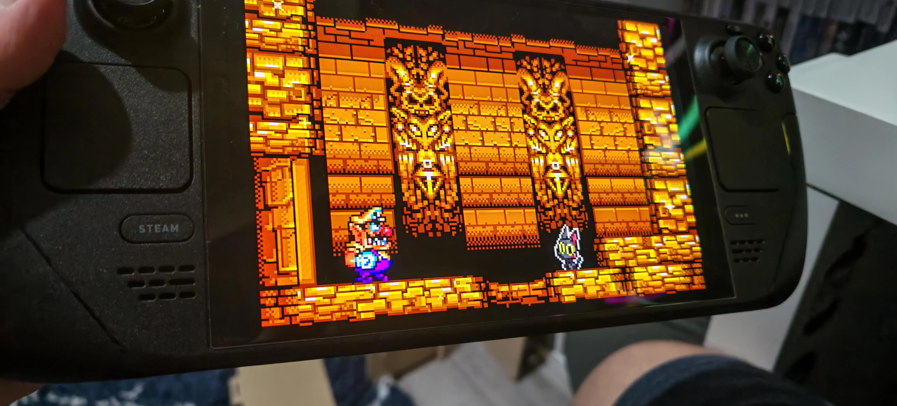

# Wario Land 4 — Native PC Port

Play Wario Land 4 with native x86-64 builds for Windows and Linux. The port
compiles the decompiled game C code and uses SDL3 for graphics, audio and input;
it does not run through Wine or Proton. **You must provide your own supported,
unmodified US ROM.** No ROM or extracted game assets are included.

## Latest beta downloads

| Platform | Release | What to download |
| --- | --- | --- |
| Windows x64 | [v0.3.2-beta](https://github.com/BioRhythmicStudios/warioland4/releases/tag/v0.3.2-beta) | `WarioLand4-Native-PC-Port-v0.3.2-beta-Windows-x64.zip` |
| Linux x86-64 / Steam Deck | [v0.1.0-beta](https://github.com/BioRhythmicStudios/warioland4/releases/tag/linux-v0.1.0-beta) | `Wario_Land_4-v0.1.0-beta-x86_64.AppImage` |

On Windows, extract the ZIP and open `wl4-launcher.exe`. On Linux, mark the
AppImage executable and open it; its graphical launcher lets you browse for your
ROM and configure controls, fullscreen, VSync, CRT effects and rumble. The Linux
release needs glibc 2.38 or newer and stores saves and settings in persistent XDG
user directories. See the [Linux installation and save guide](https://github.com/BioRhythmicStudios/warioland4/blob/linux-port/port/appimage/README_APPIMAGE.md).

In Steam Deck Desktop Mode, select **Gamepad Mode** for the built-in controls.
The default Desktop Layout maps B to Escape, which intentionally quits the game.
You can also add the AppImage to Steam as a Non-Steam Game without enabling Proton.
Steam Machine hardware testing is still pending.

These releases include the Toy Block Tower post-Keyzer red-pipe crash fix, the
Golden Diva ending/credits hang fix, and the passage boss-door transition fix.
The environmental-tile address fix also covers the exact fault address reported
in the Doodle Woods bonus-room screenshot; that particular room has not yet had
a separate gameplay retest.

## Screenshots

### Native Linux gameplay on Steam Deck



*Steam Deck photo supplied by the maintainer. The native Linux AppImage was
tested through every boss, Golden Diva, the ending and the full credits.*

### Native Windows gameplay


*Wario Land 4 running natively on Windows using the BioRhythmicStudios PC port.*

This is an unofficial fan project by **BioRhythmicStudios**, built on the
[Wario Land 4 decompilation by TsilaAllaoui and contributors](https://github.com/TsilaAllaoui/warioland4),
which derives from [lilDavid's original project](https://github.com/lilDavid/warioland4).
Their reverse engineering and decompilation work provides the foundation for
this port. It is unaffiliated with Nintendo.

## Status and features

| Status | Capabilities |
| --- | --- |
| Available on Windows x64 and Linux x86-64 | Native game and graphical ROM/settings launchers |
| Implemented | SDL3 graphics and audio, scaling, fullscreen, fast forward, VSync and CRT Lite/Enhanced filters |
| Implemented | Customizable keyboard/gamepad bindings, hotplug and optional controller rumble |
| Implemented | Persistent 32 KiB SRAM saves compatible with mGBA `.sav` files |
| Tested on real Steam Deck hardware | Boss-door entry, every boss, Golden Diva, complete ending and credits |
| Automated regression coverage | Headless boss-door, credits, Toy Block Tower tile-wrap, BIOS, I/O and disposable-save checks |
| Still being validated | Continuous full-game coverage on Windows and Steam Machine hardware |

The original GBA build remains byte-identical to this repository's baseline:
fresh `build/v7-84` produced MD5 `940b597bef3be3f4041021b47a2f4096`, with
all 202 object files unchanged. This is the decompilation build's checksum,
**not** the checksum of the supported input ROM.

## Bring your own ROM

You must supply your own legally obtained, unmodified Wario Land 4 ROM. This
repository does not provide a ROM or instructions for obtaining copyrighted game data.

The native port currently accepts only:

| Property | Required value |
| --- | --- |
| Version | US/EU, game code `AWAE` |
| Size | 8 MiB (8,388,608 bytes) |
| MD5 | `5fe47355a33e3fabec2a1607af88a404` |

The loader checks the size and MD5 and rejects other images. Japanese ROMs,
modified ROMs and ROM hacks are not currently supported by the native runtime.
No asset extraction or GBA compiler is required for a normal PC build using the
checked-in generated files.

## Build on Windows

Use the branch containing the native port (`port` in this repository). The documented
toolchain is **llvm-mingw, UCRT x86_64**, with **CMake 3.20+**, **Ninja** and **SDL3**.
The recorded setup uses llvm-mingw `20261006` and SDL3 `3.4.18`. MSVC is not the
documented build path.

1. Unpack [llvm-mingw](https://github.com/mstorsjo/llvm-mingw) and the MinGW SDL3
   development package from [SDL releases](https://github.com/libsdl-org/SDL/releases).
2. Put CMake, Ninja and llvm-mingw's `bin` directory on your `PATH`.
3. From the repository root, configure and build in PowerShell, replacing the paths
   below with your local installation directories:

```powershell
cmake -S . -B build_pc -G Ninja `
  --toolchain port/cmake/llvm-mingw-x86_64.cmake `
  -DLLVM_MINGW=C:/toolchains/llvm-mingw `
  -DCMAKE_BUILD_TYPE=RelWithDebInfo `
  -DSDL3_DIR=C:/toolchains/SDL3-3.4.18/x86_64-w64-mingw32/lib/cmake/SDL3
cmake --build build_pc
```

`SDL3_DIR` must point to the development package's `lib/cmake/SDL3` directory.
When SDL3 is found, the build copies `SDL3.dll` beside `wl4.exe`. Without SDL3,
the executable supports headless operation only.

For an AddressSanitizer build, configure a separate directory with `-DWL4_ASAN=ON`.
When running it, also add llvm-mingw's `x86_64-w64-mingw32/bin` directory to `PATH`
so the ASan runtime DLL can be found. See [port/README.md](port/README.md) for
runtime and generated-symbol maintenance details.

## Run and play

Pass the path to your supported ROM:

```powershell
.\build_pc\wl4.exe "C:\Games\Wario Land 4\baserom_us.gba"
```

The default window scale is 3×. Use `--scale N` to choose another integer scale.

| Key | Action |
| --- | --- |
| Arrow keys | D-pad |
| X / Z | A / B |
| A / S | L / R |
| Enter / Backspace | Start / Select |
| Tab (hold) | Fast forward; audio is dropped while fast forwarding |
| F11 | Toggle fullscreen |
| Escape | Quit |

The default gamepad mapping uses positional buttons: bottom face button = A,
right face button = B. The graphical launcher can customize bindings.

Windowed play stores saves at `%APPDATA%\wl4\wl4.sav` by default. To choose a
save file:

```powershell
.\build_pc\wl4.exe "C:\Games\baserom_us.gba" --save "C:\Games\wl4.sav"
```

Saves use mGBA's raw 32 KiB SRAM format and can be transferred between the two.
The runtime uses atomic replacement after SRAM changes settle and also saves on
quit. Back up existing saves before development testing; headless runs write saves
only when `--save FILE` is supplied and can overwrite that file.

## Known bugs and limitations

- Continuous end-to-end gameplay coverage remains incomplete. The Steam Deck
  ending/credits route passed on real hardware, but this does not establish that
  every stage and transition is bug-free. The Doodle Woods bonus room still
  awaits a focused manual retest after its matching address fault was fixed.
- Native code does not consume modeled GBA CPU time, so lag frames may differ.
  Pixel-perfect and audio equivalence have not been established for every scene.
- Only the supported unmodified US ROM is accepted. Japanese ROMs and ROM hacks
  are not supported by the native runtime.
- Some graphics, audio and controller behavior depends on host drivers. Steam
  Machine hardware compatibility has not yet been tested.

See [the port plan](docs/PC_PORT_PLAN.md) and the
[Linux guide](https://github.com/BioRhythmicStudios/warioland4/blob/linux-port/port/appimage/README_APPIMAGE.md)
for detailed implementation notes, save locations and remaining limitations.

## Recorded test status

The Windows v0.3.2-beta and Linux v0.1.0-beta release builds passed focused
boss-door and full-credits regressions using disposable copies of the reported
save; the credits completed at frame 15263. BIOS, I/O and Toy Block Tower
tile-wrap checks passed on both platforms. The Windows package passed a
disposable-save test and both graphical launchers passed startup checks. The
Linux AppImage game executable is byte-identical to the private build used in
the maintainer's successful real Steam Deck boss/ending/credits playthrough.
The released artifacts contain no ROMs or personal saves.

Earlier Hall of Hieroglyphs memory and picture comparisons against mGBA are
documented in [CODEX_HANDOVER.md](CODEX_HANDOVER.md) and the
[port plan](docs/PC_PORT_PLAN.md). They cover selected windows, not a complete
frame-by-frame comparison of the whole game.

## Technical architecture

- **Native game code:** `src/` is compiled for x86-64 with `PORTABLE` defined.
  Platform-specific replacements handle BIOS services and routines originally in ARM
  assembly; there is no ARM instruction interpreter running the game logic.
- **Compatible memory layout:** GBA regions are reserved at their original addresses.
  Pointers stored in game memory remain 32-bit GBA addresses through `GBA_PTR`
  accessors, preserving layouts for comparison with mGBA. The user's ROM is mapped
  read-only, and generated symbols connect game data references to its addresses.
- **Function dispatch and stack:** generated tables translate GBA function addresses
  into native calls. A patched minicoro runs the game on a guarded low-address native
  stack and yields to the host at frame boundaries.
- **Hardware services:** Windows exception and Linux signal handlers trap and
  single-step GBA I/O accesses, applying register effects, DMA and interrupts. A software scanline renderer
  implements GBA backgrounds, sprites, windows, blending, brightness and mosaic.
- **Audio and presentation:** a C translation of the game's m4a assembly works with
  modeled PSG, Direct Sound FIFOs, timers and mixing. SDL3 supplies the window,
  keyboard/gamepad input and audio output.
- **Diagnostics:** headless scripted runs can capture memory (`--dump`), framebuffers
  (`--shots`) and audio (`--wav`). Tools in `port/tools/` compare captures against mGBA.

Shared-source changes are designed to preserve the GBA build byte for byte. See
[port/README.md](port/README.md) for implementation details and
[docs/PC_PORT_PLAN.md](docs/PC_PORT_PLAN.md) for decisions, milestones and caveats.

## Original GBA decompilation

The upstream project targets these original ROM versions:

- US/EU: `5fe47355a33e3fabec2a1607af88a404` (default).
- JP: `99c8ad779a16be513a9fdff502b6f5c2`.

This describes the GBA decompilation targets; the PC runtime currently supports US/EU only.

<!-- DECOMP_PROGRESS:START -->
### Decompilation progress

Upstream reports C equivalents for all functions. Some inline assembly and unmatched
code remain, so this does not mean the current GBA rebuild is byte-identical to the
original retail ROM.


[Open the upstream interactive progress treemap](https://TsilaAllaoui.github.io/warioland4/progress.html).
<!-- DECOMP_PROGRESS:END -->

The original GBA build uses `binutils-arm-none-eabi`, `clang-format`, Python 3 and
the agbcc compiler submodule. In a standalone checkout prepared for GBA development:

```sh
git submodule update --init
make tools
make extract
make
```

Place your US/EU ROM at `baserom_us.gba` before extraction. For JP, use
`baserom_jp.gba` and add `VERSION=jp` to both `make extract` and `make`.
`make tools` also prepares the asset extractor's Python environment. Run `make help`
for further options. A fully matching build reports `build/us/warioland4_us.gba: OK`;
the current unmatched build is subject to the checksum caveat above.

## Credits and licensing

- **TsilaAllaoui and all upstream contributors:** the Wario Land 4 decompilation on
  which this native port is built.
- **lilDavid and contributors:** the original decompilation project and its MIT-licensed
  foundation.
- **BioRhythmicStudios:** native PC port development, integration and validation.
- **AI-assisted development:** Claude Code, Codex and GPT-6 assisted with development,
  debugging, analysis and documentation under human direction and review. These tools
  do not replace the original decompilation authors' credit or imply independent
  verification of the entire game.
- **Supporting projects:** SDL3 for presentation and input; minicoro for coroutines;
  llvm-mingw, Clang, CMake and Ninja for the native build; agbcc and the GBA tooling
  for the original build; mGBA as the reference for behavioral comparisons.

The restored [LICENSE](LICENSE) contains the MIT license and
**Copyright (c) 2025 lilDavid**. Preserve that notice and its terms for the covered
portions. As documented in the port plan, TsilaAllaoui's own additions have no stated
license; the restored MIT file should not be read as resolving that gap or granting
blanket permission for every contribution. This README does not relicense the project.

Vendored minicoro offers public-domain or MIT-0 terms and includes MIT-licensed
LuaCoco context-switch code by Mike Pall. Preserve applicable third-party notices;
see [the vendored source](port/third_party/minicoro/minicoro.h). Dependencies retain
their respective licenses.

Wario Land 4 and its game assets belong to Nintendo and their respective rights
holders. The repository's code licensing does not grant rights to distribute the
original ROM or copyrighted game assets.
